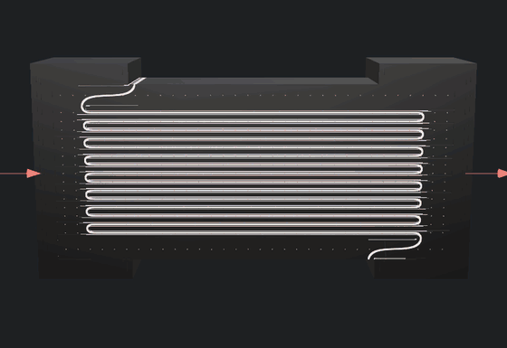
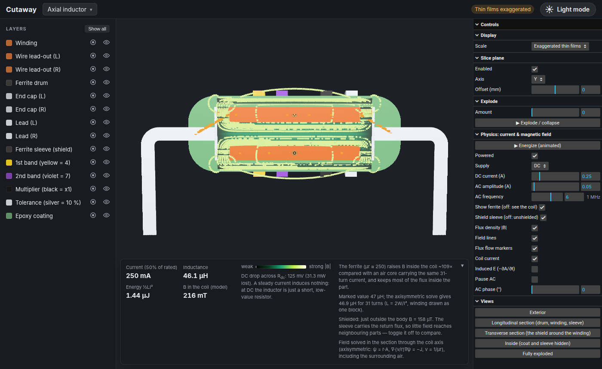
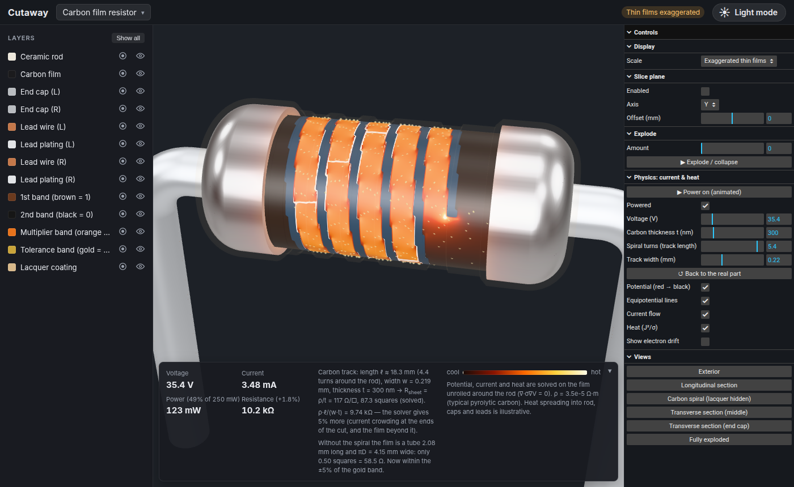

<div align="center">

# Cutaway

**See inside electronic components and watch how they work.**

### [▶ Open the live demo](https://shmmolo8.github.io/Cutaway/?component=mlcc_0603&physics=ac)



<sub>A ceramic chip capacitor sliced open under AC. The plates swap polarity every half cycle
(red +, blue −) and arrows show the current charging them. The demo opens on exactly this view;
pick any other component from the menu at the top.</sub>

</div>

Cutaway is an interactive 3D viewer that slices real electronic components open. You can see
how each one is built, layer by layer, and watch the physics that makes it work: current, heat,
electric and magnetic fields. It runs in the browser; nothing to install.

## What you can do

- **Slice** any part with a moving section plane. Every internal layer shows a solid, coloured cut face.
- **Explode** the layers apart, or pick a ready-made view (section, inside, exploded).
- **Click any layer** to see what it is, what it is made of, how thick it is and why it is there.
- **Switch the scale.** Films only nanometres thick are exaggerated so you can see them. One switch shows true scale.
- **Run the physics**, solved live in the browser, then change the design and watch the result change.

| Axial inductor: magnetic flux | Carbon film resistor: current and heat |
|---|---|
|  |  |

| Component | What the physics view shows |
|---|---|
| Chip resistor | Current flow, potential and heat in the film. Laser-trim slider sets the resistance. |
| Carbon film resistor | Current through the spiral-cut film. Film thickness, turns and track width set the resistance. |
| Trimmer potentiometer | Turn the screw and the wiper moves. Voltage divider, with and without a load. |
| Ceramic chip capacitor (MLCC) | Field between the plates, plate charge, dipoles in the ceramic, AC with displacement current. |
| Ceramic disc capacitor | Same field view. Thickness, electrode size and εr reshape the part and set the capacitance. |
| Aluminium electrolytic / tantalum | Field in the nanometre oxide. Forming voltage, etch gain and foil/pellet size. Reverse-voltage warning. |
| Chip inductor / axial inductor | Magnetic field and flux lines, energizing transient, induced E, AC. Shield on/off. |

All geometry is generated from parameter files (dimensions from datasheets) and checked
against the manufacturers' 3D models. The physics is a real numerical solution, not an
animation. Each view states clearly what is solved and what is only illustrative.

## Run it locally

The [live demo](https://shmmolo8.github.io/Cutaway/) needs nothing. To run it on your own computer you only need [Node.js](https://nodejs.org) 22 LTS or newer. The 3D models are already in `build/`.

**Linux / macOS**

```bash
cd viewer
npm install
npm run dev
```

**Windows** (PowerShell or Command Prompt)

```bat
cd viewer
npm install
npm run dev
```

Then open http://localhost:5173 and pick a component from the menu in the top bar.

## Using the viewer

- **Mouse:** left-drag rotates, right-drag pans, scroll zooms. Hover over a layer to name it; click it for details.
- **Right panel:**
  - *Slice plane*: axis and offset.
  - *Explode*: pull the layers apart.
  - *Views*: one-click presets.
  - *Physics*: ▶ starts an animated power-on sequence; the sliders change the design or the operating point.
- **Left panel:** show, hide or isolate single layers.
- **Top right:** light / dark mode.

## Rebuilding the models (optional)

You only need this to change a component or add one. It needs Python 3.11+ (build123d / OpenCascade).

**Linux / macOS**

```bash
make setup     # Python venv + viewer packages
make export    # generate, validate and export every component
make test      # geometry checks (closed solids, no overlaps, size vs reference model)
make dev       # start the viewer
```

**Windows** (PowerShell)

```powershell
py -3 -m venv .venv
.venv\Scripts\pip install -e .
$env:PYTHONPATH = "."
.venv\Scripts\python -m geometry.build      # generate + validate + export
.venv\Scripts\python -m pytest -q           # geometry checks
```

Each component is one YAML file in `data/` and one generator in `geometry/components/`.
The viewer is generic and picks up new components automatically. [CLAUDE.md](CLAUDE.md) has
the full conventions: units, axes, the no-overlap rule, the metadata schema and the physics
solvers.

| Path | What |
|---|---|
| `data/` | Parameter file per component + shared material library |
| `geometry/` | Python (build123d) generators, layer carving, validation, GLB export |
| `viewer/` | TypeScript + three.js viewer and in-browser physics solvers |
| `tests/`, `viewer/tests/` | Geometry tests (pytest) and viewer / physics tests (Playwright) |
| `Components/` | KiCad reference models, used only to check bounding boxes |

## Roadmap

Passive components first, then active ones: diodes and transistors from the inside. After
that, simple circuits that show how current actually flows, with Maxwell's equations
alongside.

## License and credits

Code and generated models: [MIT](LICENSE).

Reference 3D models in `Components/` are from the [KiCad library](https://gitlab.com/kicad/libraries/kicad-packages3D)
(CC BY-SA 4.0). They are used only to validate dimensions; every model shown is generated from scratch.
